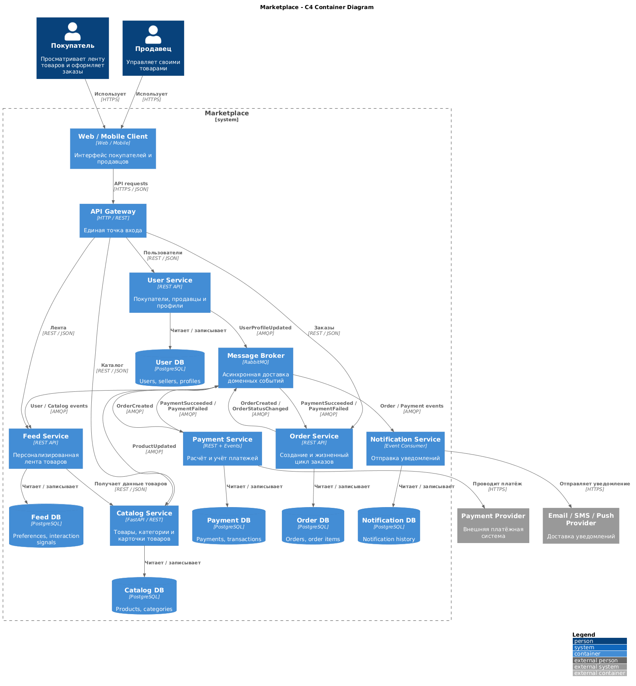

# Marketplace Architecture

Архитектурное проектирование маркетплейса с использованием C4 Model.

В рамках задания проектируется целевая архитектура системы. Бизнес-логика намеренно не реализуется. Физически реализован только один минимальный сервис — `catalog-service`, предоставляющий endpoint `/health`.

## C4 Container Diagram

Исходный код диаграммы находится в `docs/c4-container.puml`.

Диаграмма показывает:

- покупателей и продавцов;
- границу системы Marketplace;
- основные сервисы;
- отдельные базы данных;
- синхронные взаимодействия;
- асинхронные взаимодействия через RabbitMQ;
- внешнего платёжного провайдера;
- внешнего провайдера уведомлений.

## Домены и ответственность

### User

`User Service` отвечает за покупателей, продавцов и профили пользователей.

### Catalog

`Catalog Service` отвечает за товары, категории, карточки товаров и связь товара с продавцом.

Catalog Service является единственным владельцем данных каталога.

### Feed

`Feed Service` отвечает за формирование и персонализацию товарной ленты.

Персонализация может учитывать:

- категории, которыми интересовался пользователь;
- предыдущие взаимодействия с товарами;
- популярность товаров;
- новизну товаров.

Для нового пользователя используется fallback на популярные и новые товары.

### Order

`Order Service` отвечает за создание заказа, позиции заказа, статус и жизненный цикл заказа.

В заказе сохраняются необходимые данные на момент оформления, например цена товара. Order Service не читает базу Catalog Service напрямую.

### Payment

`Payment Service` отвечает за расчёт и учёт платежей, их состояния, транзакции и интеграцию с внешним платёжным провайдером.

### Notification

`Notification Service` отвечает за email, SMS и push-уведомления, а также историю доставки.

Уведомления обрабатываются асинхронно и не блокируют основной процесс заказа.

## Распределение доменов по сервисам

| Домен | Сервис | Ответственность |
|---|---|---|
| Users | User Service | Покупатели, продавцы, профили |
| Catalog | Catalog Service | Товары и категории |
| Feed | Feed Service | Персонализированная выдача |
| Orders | Order Service | Заказы и их состояния |
| Payments | Payment Service | Расчёт и учёт платежей |
| Notifications | Notification Service | Отправка уведомлений |

Разделение выполнено по бизнес-ответственности.

Это позволяет независимо изменять и масштабировать разные области системы. Например, Feed может развиваться независимо от Payment, а Notification — независимо от Order.

## Владение данными

Используется принцип **Database per Service**.

| Сервис | Собственные данные |
|---|---|
| User Service | users, sellers, profiles |
| Catalog Service | products, categories |
| Feed Service | preferences, interaction signals |
| Order Service | orders, order_items |
| Payment Service | payments, transactions |
| Notification Service | notification history, delivery status |

Разделяемых баз данных между сервисами нет.

Сервис не должен напрямую читать или изменять базу данных другого сервиса.

Данные между сервисами передаются через синхронные API или асинхронные доменные события.

## Взаимодействие сервисов

### Синхронное взаимодействие

HTTP/REST используется, когда результат необходим вызывающей стороне сразу.

Примеры:

- Client -> API Gateway;
- API Gateway -> User Service;
- API Gateway -> Catalog Service;
- API Gateway -> Feed Service;
- API Gateway -> Order Service;
- Feed Service -> Catalog Service.

### Асинхронное взаимодействие

Для доменных событий используется `RabbitMQ`.

Примеры событий:

- `OrderCreated`;
- `OrderStatusChanged`;
- `PaymentSucceeded`;
- `PaymentFailed`;
- `ProductUpdated`;
- `UserProfileUpdated`.

Пример сценария оплаты:

1. Order Service создаёт заказ.
2. Публикуется событие `OrderCreated`.
3. Payment Service получает событие.
4. Payment Service фиксирует результат платежа.
5. Публикуется `PaymentSucceeded` или `PaymentFailed`.
6. Order Service изменяет состояние заказа.
7. Notification Service отправляет уведомление.

Между сервисами допускается **eventual consistency**.

Распределённая транзакция между несколькими базами данных не используется.

## API Gateway

API Gateway является единой внешней точкой входа.

Он отвечает за:

- маршрутизацию;
- централизованную аутентификацию;
- rate limiting;
- техническое логирование.

Бизнес-логика в API Gateway не размещается.

## Вариант 1 — модульный монолит

Все бизнес-домены находятся внутри одного приложения, но разделены на внутренние модули: Users, Catalog, Feed, Orders, Payments и Notifications.

### Плюсы

- проще разработка;
- простой локальный запуск;
- простой deployment;
- меньше инфраструктуры;
- проще транзакции;
- подходит небольшой команде.

### Минусы

- приложение масштабируется целиком;
- Feed и Catalog нельзя масштабировать независимо;
- сбой может затронуть всё приложение;
- со временем может увеличиться связанность доменов;
- нет независимого deployment отдельных областей.

## Вариант 2 — доменные микросервисы

Каждый крупный домен выделяется в отдельный сервис с собственными данными.

### Плюсы

- независимое масштабирование;
- независимый deployment;
- чёткие границы ответственности;
- изоляция финансового домена;
- независимое развитие сервисов;
- Feed масштабируется независимо от Payment;
- Notification естественно работает через события.

### Минусы

- сложнее инфраструктура;
- появляются сетевые ошибки;
- нужен Message Broker;
- сложнее локальная разработка;
- необходим мониторинг распределённой системы;
- возникает eventual consistency;
- сложнее транзакции между доменами.

## Trade-offs и финальный выбор

Микросервисы не являются автоматически лучшим решением.

Для небольшой команды и продукта на ранней стадии модульный монолит был бы проще и дешевле.

Однако в рассматриваемом маркетплейсе домены имеют разные характеристики:

- Feed является read-heavy и может иметь высокую нагрузку;
- Catalog интенсивно используется при просмотре товаров;
- Payment содержит критичные финансовые данные;
- Order имеет отдельный жизненный цикл;
- Notification подходит для асинхронной обработки.

В качестве целевой архитектуры выбрана **доменная микросервисная архитектура**.

Причины выбора:

1. естественные границы бизнес-доменов;
2. отдельное владение данными;
3. независимое масштабирование;
4. изоляция финансового домена;
5. слабая связанность через события;
6. возможность независимо развивать сервисы.

Цена решения:

- более сложная инфраструктура;
- сетевое взаимодействие;
- eventual consistency;
- повышенные требования к monitoring и observability.

## Реализованный сервис

Физически реализован только `catalog-service`.

Стек:

- Python 3.10;
- FastAPI;
- Uvicorn;
- Docker;
- Docker Compose.

Бизнес-функциональность отсутствует.

Health-check endpoint: `GET /health`.

Пример тела ответа: `{"status":"ok","service":"catalog-service"}`.

Ожидаемый HTTP status: `200 OK`.

## Запуск проекта

Требования:

- Docker;
- Docker Compose v2.

Запуск из корня проекта:

`docker compose up --build -d`

Проверка состояния контейнера:

`docker compose ps`

Контейнер должен перейти в состояние `healthy`.

Проверка endpoint:

`curl -i http://localhost:8000/health`

Остановка:

`docker compose down`

## Структура репозитория

- `README.md` — описание архитектуры и решений;
- `docker-compose.yml` — запуск сервиса;
- `docs/c4-container.puml` — C4 Container Diagram;
- `services/catalog-service/Dockerfile` — Docker-образ сервиса;
- `services/catalog-service/requirements.txt` — Python-зависимости;
- `services/catalog-service/app/main.py` — минимальный сервис.

## Архитектурные решения

### ADR-001: декомпозиция по бизнес-доменам

Сервисы выделены по бизнес-ответственности, а не по техническим слоям.

### ADR-002: Database per Service

Каждый сервис самостоятельно владеет своими данными. Shared Database между сервисами отсутствует.

### ADR-003: REST для синхронных операций

HTTP/REST используется там, где вызывающей стороне необходим немедленный ответ.

### ADR-004: события для слабосвязанных процессов

RabbitMQ используется для распространения доменных событий и уменьшения связанности сервисов.

### ADR-005: Notification вне критического пути

Уведомления выполняются асинхронно и не блокируют оформление или оплату заказа.

### ADR-006: минимальная реализация

В соответствии с условиями задания бизнес-логика не реализуется.

Catalog Service существует как минимальный запускаемый сервис с endpoint `/health`.
